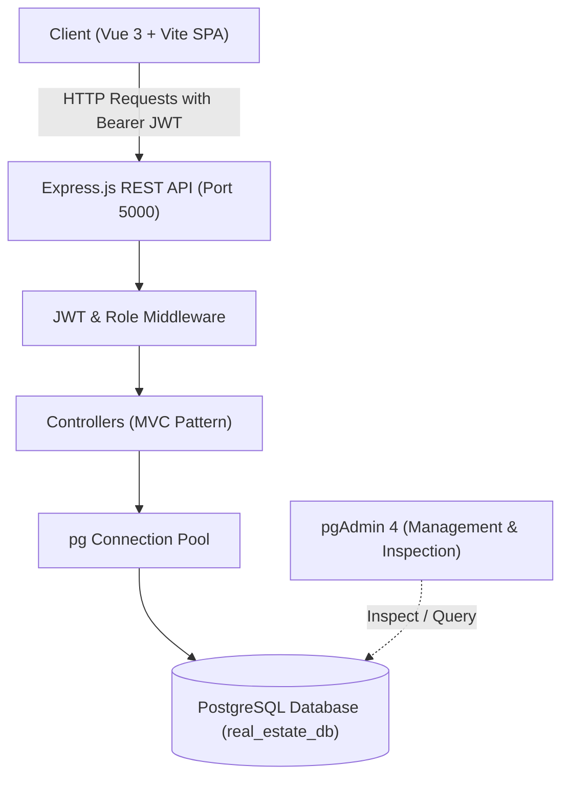

# 🏡 RealEstatePro - Project Documentation & Presentation Guide

This document is prepared for your school project presentation and code demonstration to your teacher. It includes:
1. **Executive Project Overview**
2. **Complete Technology Stack & Architecture**
3. **Database Architecture & PostgreSQL / pgAdmin Integration**
4. **Backend & Frontend Code Walkthrough**
5. **Security & Best Practices Implementation**
6. **Live Demonstration Script (Step-by-Step for Teacher)**
7. **Complete Ready-to-Use Presentation Slides (Slide 1 to 12)**

---

## 1. Project Overview

### 1.1 Project Title
**RealEstatePro - Full-Stack Real Estate Management & Listing Platform**

### 1.2 Objective
RealEstatePro is a full-stack web application designed to connect property seekers, licensed real estate agents, and system administrators into a single unified platform. The platform handles end-to-end real estate operations including:
- Browsing, filtering, and searching properties for sale and rent.
- Customer booking for property tours and submitting inquiries.
- Role-based management for Customers, Agents, and Administrators.
- Real-time statistics and analytics dashboard.
- Full transactional database management powered by **PostgreSQL**.

---

## 2. Technology Stack & Why They Were Chosen

| Layer | Technology | Purpose & Why Chosen |
|---|---|---|
| **Frontend Framework** | **Vue.js 3** | Reactive component-based UI using Modern Vue 3 Composition & Options API for fast UI rendering. |
| **Build Tool** | **Vite 5** | Extremely fast Hot Module Replacement (HMR) and optimized production bundle builds. |
| **State Management** | **Pinia** | Modern, lightweight, type-safe global state store for authentication tokens and user sessions. |
| **Client Routing** | **Vue Router 4** | Single Page Application (SPA) client-side routing with navigation guards for protected routes. |
| **HTTP Client** | **Axios** | Promised-based HTTP client with interceptors to automatically attach JWT authorization headers. |
| **Backend Runtime** | **Node.js** | High-performance asynchronous, non-blocking I/O event-driven JavaScript runtime. |
| **API Framework** | **Express.js 4** | Minimalist and flexible web framework for architecting RESTful APIs using the MVC pattern. |
| **Database** | **PostgreSQL** | Enterprise-grade, relational SQL database with ACID compliance, relational integrity, and high query concurrency. |
| **Database GUI** | **pgAdmin 4** | Professional database administration client used to inspect schemas, visualize relations, and monitor queries. |
| **Database Driver** | **`pg` (node-postgres)** | Native Node.js client pool supporting connection pooling and parameterized query protection against SQL Injection. |
| **Authentication** | **JSON Web Tokens (JWT)** | Stateless authentication mechanism for secure and verifiable client-server communication. |
| **Password Security** | **Bcrypt.js** | Industry standard one-way salted hashing algorithm to secure user credentials. |
| **File Handling** | **Multer** | Multipart form-data parser for property image uploads with MIME validation and disk storage. |

---

## 3. System Architecture & Project Structure

The project follows a decoupled **Client-Server Architecture (REST API)**:



### Directory Structure

```
RealEstatePro_Upgraded/
├── backend/
│   ├── src/
│   │   ├── config/          # Database pool connection & environment parser
│   │   │   ├── database.js  # PostgreSQL pg.Pool configuration & query wrappers
│   │   │   └── env.js       # Centralized env validation
│   │   ├── controllers/     # Business logic layer (MVC)
│   │   │   ├── authController.js
│   │   │   ├── propertyController.js
│   │   │   ├── userController.js
│   │   │   ├── appointmentController.js
│   │   │   ├── inquiryController.js
│   │   │   ├── dashboardController.js
│   │   │   └── ...
│   │   ├── database/        # Migrations, seed scripts, & SQL schema
│   │   │   ├── migrate.js   # Automated migration runner for PostgreSQL
│   │   │   ├── seed.js      # Default admin, property types, and locations seeder
│   │   │   └── seedProperties.js
│   │   ├── middleware/      # Auth, roles, error handling, security headers
│   │   ├── routes/          # Express route definitions
│   │   ├── utils/           # Input validation, sanitization, response helpers
│   │   ├── app.js           # Express app setup, CORS, and middleware pipeline
│   │   └── server.js        # Server entry point & startup runner
│   ├── .env                 # Database credentials and application secrets
│   └── package.json
└── frontend/
    ├── src/
    │   ├── components/      # Reusable UI components (Navbar, PropertyCard, Modal)
    │   ├── views/           # Page views (Home, Properties, Details, Dashboard, Admin)
    │   ├── stores/          # Pinia stores (auth store, property store)
    │   ├── router/          # Vue Router configurations & navigation guards
    │   ├── services/        # Axios API client functions
    │   ├── App.vue          # Root Vue component
    │   └── main.js          # Vue initialization
    └── package.json
```

---

## 4. Database Design (PostgreSQL & pgAdmin)

### 4.1 Key Relational Tables

1. **`users`**: Manages all user accounts with roles: `'admin'`, `'agent'`, `'customer'`.
2. **`property_types`**: Categorizes properties (Villa, Apartment, Condo, House, Office, Land).
3. **`locations`**: Stores geographical data (provinces, cities, districts, coordinates).
4. **`properties`**: Primary entity storing property listings with prices, specifications, listing types (`sale`/`rent`), and agent assignments.
5. **`property_images`**: Multi-image gallery per property (`ON DELETE CASCADE`).
6. **`favorites`**: Many-to-many relationship tracking saved properties per customer.
7. **`inquiries`**: Direct customer inquiries submitted for specific properties.
8. **`appointments`**: Scheduling system for viewing properties with assigned agents.
9. **`service_requests`**: Requests for maintenance, property valuation, or legal inspections.
10. **`agent_requests`**: Application workflow for customers requesting promotion to agent status.
11. **`schema_migrations`**: Tracks executed migration versions to ensure idempotency.

### 4.2 Migration Highlights (Upgraded from SQLite to PostgreSQL)
- **Data Types**: Transitioned from SQLite dynamic typing to strong PostgreSQL types (`SERIAL PRIMARY KEY`, `TIMESTAMP`, `TEXT`, `REAL`, `INTEGER`).
- **Parameterized Queries**: Converted query binding from `?` to PostgreSQL native `$1, $2, ...` syntax via an intelligent helper wrapper in `database.js`.
- **Case-Insensitive Search**: Optimized search with PostgreSQL `ILIKE`.
- **Date & Time Aggregations**: Upgraded analytics queries using `to_char(created_at, 'YYYY-MM')` and native PostgreSQL interval math (`INTERVAL '5 months'`).

---

## 5. Security & Engineering Best Practices

1. **SQL Injection Prevention**: All SQL queries strictly use parameterized statements (`$1`, `$2`), never raw string concatenations.
2. **Password Security**: Bcrypt with salt rounds ensures passwords are never stored in plain text.
3. **Role-Based Access Control (RBAC)**:
   - **Customer**: Can view properties, save favorites, submit inquiries, and book appointments.
   - **Agent**: Can manage their assigned properties, reply to customer inquiries, and confirm appointments.
   - **Admin**: Full platform governance, user management, property approvals, and system-wide analytics.
4. **CORS & Safe Headers**: Configured CORS origin whitelisting and HTTP security headers (`nosniff`, `X-Content-Type-Options`).
5. **Centralized Error Handling**: Standardized error responses to prevent database stack traces from leaking to the client.

---

## 6. Live Teacher Demo Walkthrough

Follow these steps when demonstrating the project to your teacher:

```
[ Step 1: Show Database in pgAdmin 4 ]
   └── Open pgAdmin 4 -> real_estate_db -> Schemas -> Tables.
   └── Show your teacher the clean relational structure (users, properties, appointments, etc.).

[ Step 2: Start Backend & Frontend ]
   └── Terminal 1 (Backend):  npm run dev  (Shows connected to PostgreSQL on port 5000)
   └── Terminal 2 (Frontend): npm run dev  (Vite starts at http://localhost:5173)

[ Step 3: Public User Experience (Visitor / Customer) ]
   └── Open browser at http://localhost:5173.
   └── Demonstrate searching and filtering properties (by type, location, price range).
   └── Click on a property detail page to show the gallery, specs, and agent details.
   └── Log in as a customer (or register a new account).
   └── Add a property to Favorites and submit an Appointment request for a tour.

[ Step 4: Agent Experience ]
   └── Log out and log in with an Agent account.
   └── Navigate to Agent Dashboard.
   └── Show newly received tour requests and inquiries.
   └── Update the appointment status to "Approved".

[ Step 5: Administrator Control & Analytics ]
   └── Log in as Admin (admin@example.com).
   └── Open Admin Dashboard: Show charts (Property Breakdown, Monthly Inquiries, User counts).
   └── Show Property Approval workflow (Pending -> Approved).
   └── Show User Management (Promote or activate accounts).

[ Step 6: Verify in pgAdmin 4 ]
   └── Switch back to pgAdmin 4.
   └── Run: SELECT * FROM appointments ORDER BY id DESC LIMIT 1;
   └── Show the teacher that the appointment created live in the UI is stored in PostgreSQL!
```

---

## 7. Ready-to-Use Presentation Slides

You can copy these slide contents directly into **PowerPoint**, **Google Slides**, or **Canva**.

---

### Slide 1: Title Slide
- **Title**: RealEstatePro
- **Subtitle**: Modern Full-Stack Real Estate Management & Listing System
- **Presenter**: [Your Name]
- **Class / Course**: Web Development / Node.js & Database Systems
- **Instructor**: [Teacher's Name]
- **Date**: 2026

---

### Slide 2: Problem Statement & Motivation
- **The Challenge**:
  - Traditional property searching is fragmented across multiple unverified channels.
  - Manual scheduling between buyers and agents causes miscommunication and delays.
  - Lack of centralized management and data visualization for real estate agencies.
- **Our Solution**:
  - An all-in-one responsive platform connecting Buyers, Agents, and Administrators.
  - Real-time tour scheduling and inquiry tracking.
  - Dynamic analytics dashboard for business decision-making.

---

### Slide 3: Technology Architecture
- **Frontend**:
  - **Vue 3** (Reactive UI with Composition & Options API)
  - **Vite** (Next-generation lightning-fast frontend tooling)
  - **Pinia** (Centralized state management)
  - **Vue Router** (SPA route protection & navigation guards)
- **Backend**:
  - **Node.js & Express.js** (RESTful API architecture)
  - **JWT & Bcrypt.js** (Stateless authentication & password encryption)
  - **Multer** (Secure image uploads)
- **Database & Tooling**:
  - **PostgreSQL** (ACID-compliant relational database)
  - **pgAdmin 4** (Database visual administration & query management)

---

### Slide 4: Database Design & PostgreSQL Integration
- **Relational Integrity**:
  - Primary keys & foreign keys with cascade constraints (`ON DELETE CASCADE`, `ON DELETE RESTRICT`).
  - Separation of concerns across 11 relational tables.
- **Why PostgreSQL?**:
  - Reliable relational transactions, indexing, and high concurrency.
  - Upgraded from SQLite to PostgreSQL for production-ready scalability.
- **pgAdmin 4 Integration**:
  - Real-time schema inspection, index monitoring, and table query verification.

---

### Slide 5: Role-Based Access Control (RBAC)
- **Three Distinct User Personas**:
  1. **Customer**:
     - Browse & filter approved properties.
     - Save favorites, submit inquiries, and book property tour appointments.
     - Apply to become a licensed agent.
  2. **Agent**:
     - Create and update property listings.
     - Manage and respond to customer inquiries and viewing appointments.
     - Track property performance via agent dashboard.
  3. **Administrator**:
     - System-wide governance and analytics.
     - Approve or reject property listings.
     - Manage user roles, approve agent applications, and system configs.

---

### Slide 6: Key Backend Features & Implementation
- **MVC Architecture**: Clean separation between Routes, Controllers, Middleware, and Database Configs.
- **Automated Migration Runner**: Executes structured schema versioning (`schema_migrations`) automatically on server start.
- **SQL Security**:
  - Custom PostgreSQL placeholder translator converting `?` to parameterized `$1, $2, ...` to prevent SQL Injection.
- **RESTful Endpoints**:
  - Structured standard response envelope: `{ success: true, message: "...", data: {...} }`.

---

### Slide 7: Frontend Features & User Experience
- **Interactive Property Search**:
  - Multi-parameter filtering: Listing Type (Sale/Rent), Price Range, Bedrooms, Bathrooms, and Location.
- **Responsive Layout**:
  - Mobile-friendly navigation, clean property cards, dynamic badges, and image carousels.
- **Real-Time Client-Side Feedback**:
  - Axios interceptors for immediate user feedback on token expiration, permission errors, and loading states.

---

### Slide 8: Security Implementation
- **Password Protection**: 10-12 salt rounds using Bcrypt.
- **Token Security**: Signed JWT tokens with expiration periods (`7d`).
- **Route Protection**:
  - Backend: `authMiddleware` + `roleMiddleware(['admin', 'agent'])`.
  - Frontend: Vue Router navigation guards redirecting unauthorized users.
- **Input Sanitization**: Whitelisting allowed values and type checks on all request bodies.

---

### Slide 9: Live Demonstration Plan
- **Demo Flow**:
  1. **Public Property Discovery**: Searching and filtering listings.
  2. **Customer Interaction**: Booking a viewing appointment and saving a favorite.
  3. **Agent Action**: Reviewing the appointment and confirming schedule.
  4. **Admin Dashboard**: Viewing statistics, charts, and approving new property listings.
  5. **pgAdmin 4 Verification**: Live database table inspection confirming row creation.

---

### Slide 10: Technical Challenges & Key Learnings
- **Database Migration**:
  - Seamlessly upgrading from SQLite to PostgreSQL (syntax adjustments, `SERIAL`, `TIMESTAMP`, `ILIKE`, and `INTERVAL` operators).
- **Relational Integrity**:
  - Handling foreign key dependencies when deleting or reassigning agent properties.
- **State Synchronization**:
  - Keeping UI in sync across different user role transitions using Pinia.

---

### Slide 11: Future Roadmap
- Integration with live payment gateways (ABA PayWay / Credit Card for booking deposits).
- Real-time chat between Buyers and Agents using WebSockets (Socket.io).
- Interactive Google Maps / OpenStreetMap integration for property coordinates.
- Email / Telegram notifications for newly booked appointments.

---

### Slide 12: Conclusion & Q&A
- **Summary**: RealEstatePro delivers a complete, secure, full-stack real estate platform built with modern web technologies.
- **Repository & Codebase**: Organized, clean, and production-ready.
- **Thank You! Any Questions?** 💬

